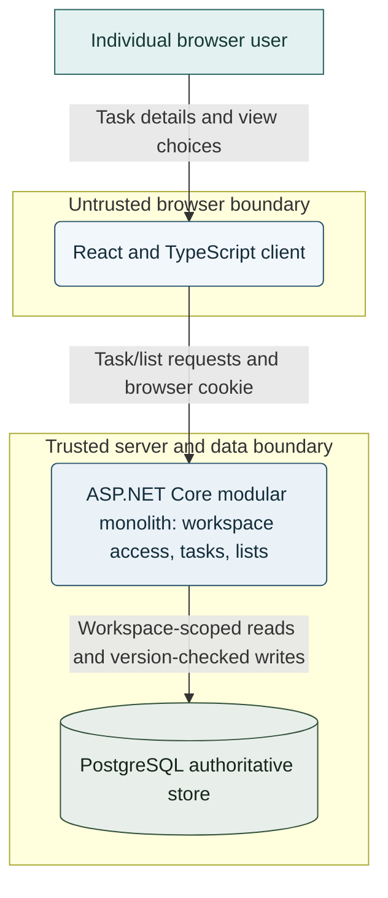
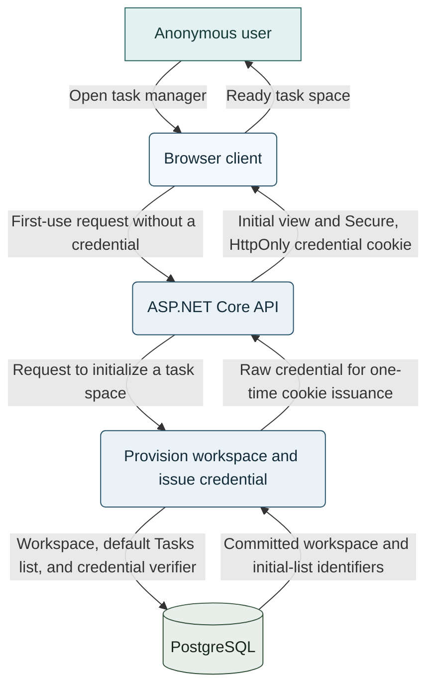
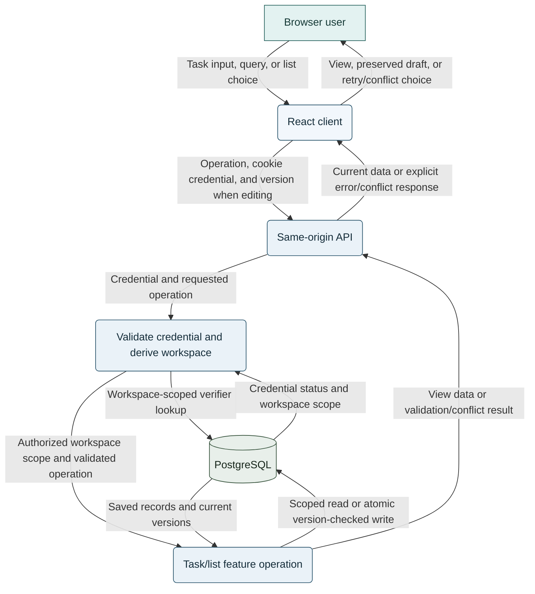

# Task Manager Architecture

## Document control

| Field | Value |
|---|---|
| Status | Proposal for technical/security/privacy/operations review; not implementation authorization |
| Requirements baseline | [Task Manager PRS v0.6](task-manager-requirements.md), approved 2026-11-13 |
| Architecture decision | Account-free, one browser, no pairing or recovery; small pilot with numeric operating targets TBD |
| Scope | Architecture for the approved individual task-manager MVP |

This proposal turns the approved product behavior and repository technology guidance into a reviewable architecture. Numeric service targets, retention policy, deployment provider, and several technical-document conflicts remain open. No user volumes, budget, schedule, or compliance obligations were supplied.

## Goals and constraints

### Goals

- Support the approved browser workflows for tasks, named lists, priority, search, completion, due dates, and overdue state.
- Persist confirmed changes in a workspace isolated from all other anonymous workspaces.
- Preserve unsaved drafts and prevent stale edits from replacing newer data.
- Keep the pilot operable with a small number of components and without infrastructure that has no demonstrated need.

### Requirements and constraints

- **Approved product behavior:** The PRS v0.6 is the source of product scope and acceptance behavior. Team sharing, cross-device sync, native apps, offline writes, reminders, and import/export are excluded.
- **Selected technologies:** React and TypeScript for the browser UI, C# and ASP.NET Core for the application/API, and PostgreSQL as the authoritative database. Exact versions, libraries, hosting provider, and deployment topology are not selected.
- **Access model for this proposal:** No account, pairing, or recovery. A task space is bound to the browser credential issued at first use. Losing or clearing that credential makes the task space inaccessible to its user; this consequence and the resulting orphaned-data retention policy require explicit review before pilot.
- **Operational scope:** Small pilot. Performance, availability, recovery, support, retention, and rate-limit targets remain TBD; do not infer production readiness from a pilot deployment.
- **Accessibility and browsers:** Validate the PRS target of WCAG 2.2 AA for core workflows and current/previous major Chrome, Edge, Firefox, and Safari before general launch.
- **Evidence boundary:** Repository instructions provide technical constraints, but some details conflict with the approved product behavior. The conflicts are listed under [Open decisions and guidance conflicts](#open-decisions-and-guidance-conflicts).

## Architecture overview

Use a browser client and one ASP.NET Core modular-monolith application/API backed by PostgreSQL. Deploy the browser client and API behind one origin when practical. The API owns identity issuance, workspace scoping, validation, concurrency checks, and persistence; the browser is not authoritative for saved task state.

There are two trust boundaries: the untrusted browser and user input, and the server-side application/data tier. The user has no account identity; possession of the opaque browser credential grants access to exactly one workspace. The credential is not a workspace identifier and must not be accepted from request bodies or URLs as proof of authorization.

**Diagram roles:** teal identifies the external user; pale blue identifies the browser client and application processes; pale green identifies persistent storage. Labels and shapes carry meaning independently of color.

## Component design

| Component | Responsibility | Boundary and design |
|---|---|---|
| Browser client | Render accessible task/list views; collect input; manage local drafts; display loading, stale, save, conflict, and error states | React/TypeScript. Keep drafts separate from confirmed server state. Do not store credentials in JavaScript storage or create offline write queues. |
| Same-origin API | Define typed request/response contracts and HTTP error behavior | ASP.NET Core. Prefer same-origin hosting or routing; choose controllers/minimal APIs during implementation planning. |
| Workspace access | Provision an anonymous workspace at first use; issue and validate an opaque credential; derive workspace scope | Persist only a secure credential verifier. Return the raw credential only in a Secure, HttpOnly cookie. No pairing or recovery endpoints in this proposal. |
| Task feature | Create, view, edit, complete/reopen, delete, filter, search, and report overdue state | Validate title and other inputs. Use workspace-scoped reads and version-checked changes. Search titles as literal, case-insensitive substrings after trimming query whitespace. |
| List feature | Create and delete named lists; assign a task to at most one list | Deleting a list and leaving its tasks unassigned must be one transaction. Follow the approved PRS if list rules conflict with technical guidance. |
| Persistence boundary | Map feature operations to parameterized PostgreSQL queries and transactions | Keep SQL and data access out of UI/endpoint code. Add indexes only after the access patterns and representative workload justify them. |
| PostgreSQL | Authoritative store for workspace, credential verifier, task, list, and version data | Enforce workspace ownership and same-workspace task/list relationships with database constraints as well as application checks. |

### Proposed data model

Use workspace-scoped records. A conceptual model is:

- `Workspace`: opaque internal ID and creation metadata.
- `WorkspaceCredential`: workspace ID, verifier, expiry/revocation state, and issuance metadata. Never store the raw cookie credential.
- `TaskList`: workspace ID, name, and timestamps.
- `Task`: workspace ID, optional list ID, title, description, date-only due date, priority, completion state, and monotonically changing version.

The optional list relationship is needed to represent the approved behavior in which deleting a list leaves its tasks intact but unassigned. Use foreign-key constraints that prevent cross-workspace references. Exact columns, uniqueness rules, indexes, migration tool, and credential expiry are implementation decisions.

### Principal data flows

**First browser visit and credential issuance.** The server creates a workspace and any required initial data atomically, persists only a verifier, and sets the opaque credential as a protected cookie. The browser never receives a workspace ID as authority and application JavaScript cannot read the cookie.

**Task/list reads and mutations.** For each protected request, validate the credential and derive workspace scope server-side. The feature module applies that scope to reads and writes. Mutations check the submitted version atomically with the update; a stale version returns the latest saved version and a conflict outcome while the client preserves its draft.

### API and consistency behavior

- Expose a small, versioned JSON API for task and list operations. Exact route names and HTTP methods are TBD in implementation specifications.
- Return distinct, non-sensitive outcomes for validation, unauthorized/expired credential, unavailable task, version conflict, rate limit, and service failure. Do not turn failed reads into an empty successful list.
- Keep task and list mutations transactional where multiple records must change together. In particular, list deletion and unassignment must commit or roll back together.
- Use an integer version or an equivalent conditional update token. A stale mutation must not overwrite a newer record or recreate a deleted task.
- Keep due dates as date-only values. Derive overdue status from the user's current local calendar date; do not convert the due date through UTC. Confirm how the browser's current time zone is interpreted before implementation.
- Do not add a cache, queue, event bus, search service, polling, or push updates for the pilot.

## Architectural patterns and options

| Option | Benefits | Costs and risks | Assessment |
|---|---|---|---|
| Browser-only storage | Simplest runtime; tasks remain in the browser | Does not use the selected ASP.NET Core/PostgreSQL stack; browser loss destroys data; no server-backed persistence or isolation model | Not recommended unless the product scope is changed |
| Modular monolith with PostgreSQL | Clear feature boundaries; transactional task/list behavior; simplest server-backed route to the approved persistence requirements | One application release unit; anonymous identity and data-retention controls need careful design | **Recommended for the pilot** |
| Microservices | Independent deploy and scale boundaries if separate workloads or ownership emerge | Distributed authorization, deployment, observability, and consistency add overhead without current scale or team evidence | Defer unless measurable needs justify the split |

Use a **modular monolith** organized around workspace access, tasks, lists, and persistence, with end-to-end feature slices. Keep the API stateless apart from protected browser credentials and database state. Use PostgreSQL transactions and optimistic concurrency rather than distributed workflows. Separate hosting of the UI and API is possible, but adds origin, cookie, and CORS decisions; prefer same-origin routing for the pilot.

Avoid introducing microservices, event-driven processing, background synchronization, offline queues, a separate search index, or shared cache before a requirement or measured bottleneck warrants them.

## Performance and scalability

- **Targets:** Not supplied. Request/response latency, throughput, maximum workspace size, availability, and recovery objectives are TBD and must be approved before general launch.
- **Pilot baseline:** One deployable application/API and one PostgreSQL service are sufficient as a starting shape; this is a simplicity recommendation, not a capacity claim.
- **Scale path:** Keep API instances replaceable and avoid in-memory session authority so additional instances can be introduced if measured load requires it. Scale the database and application independently only when telemetry supports doing so.
- **Likely bottlenecks:** Workspace-scoped task listing/search and database connection capacity. Validate query plans and indexes with representative data before adding search infrastructure or caching.
- **Required measurements:** API latency/error rate, database connection and query health, credential rejection/rate-limit counts, task-save failures, conflict frequency, and provisioning abuse signals. Do not log task content or credentials.

## Security, privacy, and compliance

- **Workspace isolation:** Treat all browser input as untrusted. Derive workspace scope only from a validated credential; scope every query and mutation. Use opaque IDs as identifiers, not as authorization.
- **Credential handling:** Generate an unpredictable credential, store only a verifier, and set it with Secure, HttpOnly, and appropriate SameSite cookie attributes. Enforce expiry and revocation server-side. Do not put credentials in URLs, JavaScript storage, logs, analytics, or screenshots.
- **Request protection:** Use same-origin deployment where practical, validate request origins for state-changing requests, apply CSRF defenses, and rate-limit workspace creation and data operations. Define numeric limits before pilot.
- **Data protection:** Use TLS in transit, protect database and backup access with least privilege, and keep deployment secrets outside source control. Encrypt stored data and backups according to the selected hosting environment and reviewed policy.
- **Task content:** Treat task text as potentially sensitive user content. Render it as text, not user-controlled HTML. Exclude content and secrets from logs, traces, and analytics.
- **Anonymous-use consequence:** Clearing browser data or losing the browser credential makes that workspace inaccessible. There is intentionally no account, pairing, or recovery flow in this proposal. Expiry, revocation, orphaned-workspace purge, abuse controls, and user-facing disclosure must be decided before pilot.
- **Deletion and backups:** Product deletion removes a task from the active workspace and has no restore feature. Backup retention and purge, and preventing deleted data from reappearing after restore, require an approved policy and tested restore process. The PostgreSQL guidance describes an independent deletion ledger and a 30-day backup window, while the approved PRS still leaves infrastructure retention/purge unresolved; confirm that these are approved and mutually consistent before implementation.
- **Compliance:** No regulatory regime or compliance status is established by the available requirements. Determine applicability with the responsible privacy/security stakeholders.

## Deployment and operations

- Use separate development, test, pilot, and production configuration and data. Do not use development/test task data in a pilot or production database.
- Keep the browser and API same-origin using either ASP.NET Core static-file hosting or a same-origin reverse proxy; decide the exact hosting arrangement after provider and operational constraints are known.
- Configure secrets outside source control. Use least-privilege application and migration database roles.
- Apply reviewed, repeatable database migrations with compatibility and rollback planning. Application rollback does not reverse a database migration.
- Provide readiness/health checks without revealing task data, credential state, or secrets. Emit sanitized structured operational logs.
- Before general launch, set numeric availability/performance/support and recovery objectives, establish backup/restore procedures, test deletion-ledger reapplication if that requirement is retained, and approve retention/purge behavior.
- Review privacy implications before instrumenting the primary pilot measure, first-task activation. Collect only the approved event data needed to compute it.

## Implementation roadmap

| Phase | Scope | Validation gate |
|---|---|---|
| 0. Architecture and policy alignment | Resolve guidance conflicts below; approve anonymous credential lifecycle, default-list behavior, purge/retention, time-zone behavior, and pilot operations scope | Product, technical, security, privacy, and operations owners record decisions; implementation authorization is explicit |
| 1. Workspace access foundation | Provision a browser-bound task space, credential verifier/cookie, workspace isolation, rate limits, and safe errors | Tests prove cross-workspace access is denied, credentials are not exposed, and expiry/revocation behavior is explicit |
| 2. Task and list vertical slices | Deliver task create/view/edit/complete/delete and list create/assign/delete with PostgreSQL transactions and version checks | Acceptance tests cover PRS behavior, list deletion/unassignment, date-only due dates, stale writes, and save failures |
| 3. Browser workflows and accessibility | Implement filters, title search, priority, overdue indication, draft preservation, and accessible feedback | Keyboard and WCAG 2.2 AA review for core flows; cross-browser validation against the PRS target |
| 4. Pilot readiness | Deploy the simple topology; establish privacy-reviewed activation measurement and operational dashboards; rehearse backup/restore | Pilot entry checklist covers security, retention, restore, monitoring, rate limits, and explicit TBD-to-approved target ownership |
| 5. General-launch gate | Review pilot evidence, set numeric activation threshold and service objectives, and close technical/privacy gates | Product and technical owners approve readiness; no unsupported scale or compliance claim is used |

Owners, dates, cost, and phase duration are TBD. The phases are dependency-ordered recommendations, not estimates.

## Open decisions and guidance conflicts

1. **Credential lifetime and orphaned data:** Define expiry, revocation, whether any credential-reset path is allowed, and how inaccessible workspaces are purged. The selected no-recovery model means the user cannot regain access after losing browser credential data.
2. **Approved list behavior vs. PostgreSQL guidance:** The PRS permits tasks to become unassigned after list deletion. The PostgreSQL instruction says every task must have a list association. Update or reconcile that instruction before schema work; the proposed model makes list association optional.
3. **No pairing/recovery vs. ASP.NET Core guidance:** The access model selected for this proposal excludes pairing and recovery, while ASP.NET Core instructions describe pairing grants and recovery controls. Reconcile those instructions before implementation; do not build pairing/recovery implicitly.
4. **Retention and deletion ledger:** The PRS leaves infrastructure retention/purge open; PostgreSQL guidance specifies a 30-day backup window and an independent deletion ledger. Confirm the approved retention policy and restore invariant with privacy/operations owners.
5. **Overdue time zone:** Confirm whether “user's current local date” means the browser's current time zone or a fixed workspace zone. The proposed account-free single-browser model can use the browser's local date, but a zone change may change overdue status.
6. **Default list behavior:** PostgreSQL guidance requires a `Tasks` list at workspace creation. Confirm how that list is presented and whether it can be deleted under the approved list behavior.
7. **Pilot deployment and targets:** Choose a hosting provider and define operational targets, rate limits, pilot size, support/monitoring ownership, and recovery objectives. Keep these TBD until owners supply evidence.
8. **Architecture approval:** The PRS is approved as a product baseline; this architecture proposal needs technical/security/privacy/operations review and explicit approval before implementation.

## Assumptions

- The approved PRS v0.6 remains the product source of truth.
- The user's follow-up choice confirms the access model for this proposal but does not silently revise the PRS or technical instructions.
- The pilot remains a small, individual-user web application without team, cross-device, or offline behavior.
- Numeric service, abuse, retention, and recovery targets are intentionally not invented.
