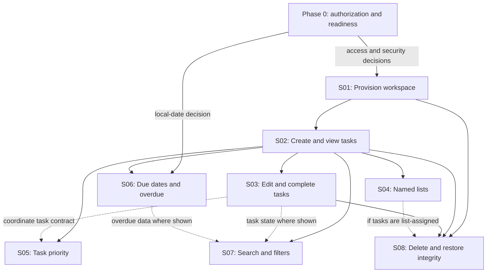

# Task Manager Vertical-Slice Implementation Roadmap

## Status and Scope

**Plan status:** Draft for execution planning. S01 implementation is authorized only through GitHub issue #2; this roadmap does not authorize other slices or production deployment.

**Product baseline:** [Task Manager PRS v0.8](task-manager-requirements.md), approved by the requester on 2026-11-13.

**Architecture baseline:** [Task Manager Architecture](task-manager-architecture.md), approved by the requester on 2026-11-13 and aligned to PRS v0.8.

The plan covers the approved individual, account-free, browser task manager: workspace access, task CRUD and status, lists, priority, due dates/overdue behavior, search, filters, and deletion. Team sharing, cross-device pairing, recovery, offline writes, native clients, recurring tasks, reminders, tags, priority sorting, and import/export are outside this baseline.

## Sources and Planning Constraints

| Source                                                                                            | Planning use                                                                                                                                                                                      |
| ------------------------------------------------------------------------------------------------- | ------------------------------------------------------------------------------------------------------------------------------------------------------------------------------------------------- |
| [Approved PRS](task-manager-requirements.md)                                                      | Product scope, TM-FR/TM-NFR acceptance criteria, user decisions, and pre-production gates.                                                                                                        |
| [Approved architecture](task-manager-architecture.md)                                             | React/TypeScript browser client, ASP.NET Core modular monolith, PostgreSQL, workspace credential boundary, persistence, transactions, concurrency, backup deletion ledger, and operational gates. |
| [Vertical-slice guidance](.github/instructions/business-rules-to-vertical-slices.instructions.md) | User-value-oriented, end-to-end, independently verifiable slices; stakeholder validation.                                                                                                         |
| [Implementation guidance](.github/instructions/vertical-slice-implementation.instructions.md)     | Feature-centric boundaries, thin shared kernel, and slice-level verification.                                                                                                                     |

- The selected technologies are React/TypeScript, C# with ASP.NET Core, and PostgreSQL. Exact versions, API style, data-access and migration libraries, test libraries, and hosting provider are not selected.
- The architecture specifies account-free, single-browser access without pairing or recovery. The requester selected a persistent Secure, HttpOnly credential cookie with a 30-day absolute expiry; technical/security validation remains required. Inaccessible-workspace purge ownership/timing and numeric rate limits remain pre-pilot gates.
- The approved due-date rule uses the user's current local date. Confirm whether that means the browser's current time zone before implementing overdue calculations.
- No schedule, estimates, team allocation, workload, budget, or hosting provider was supplied. The sequence below is dependency-based, not a duration or staffing commitment.
- The requester approved the PRS and architecture, and explicitly authorized Copilot to implement S01 through GitHub issue #2 on 2026-11-13. No authorization beyond S01 or for production deployment is implied.

## Phase Plan

| Phase                              | Objective                                                                                   | Included work                                                                                                                                                                                                                                                                                     | Exit gate                                                                                                                                                            |
| ---------------------------------- | ------------------------------------------------------------------------------------------- | ------------------------------------------------------------------------------------------------------------------------------------------------------------------------------------------------------------------------------------------------------------------------------------------------- | -------------------------------------------------------------------------------------------------------------------------------------------------------------------- |
| 0. Authorization and readiness     | Make implementation decisions explicit and distinguish S01 authorization from later review and pilot gates. | S01 authorization is recorded in issue #2; select compatible tool/library versions and API/data/migration/test approaches; obtain independent technical/security review of the selected credential lifecycle, first-use, cookie, origin/CSRF, and initialization-retry behavior before merge or deployment. Assign owners and due gates for inaccessible-workspace purge and numeric abuse limits before pilot; resolve overdue time-zone interpretation before S06. | S01 implementation may proceed under issue #2; independent technical/security review is complete before merge or deployment. Pilot and S06 gates have owners and due gates; this plan does not authorize other slices or production deployment. |
| 1. Workspace foundation            | Give one browser a secure, isolated task space.                                             | S01                                                                                                                                                                                                                                                                                               | Workspace provisioning, credential handling, and cross-workspace isolation tests pass.                                                                               |
| 2. Core task lifecycle             | Deliver durable task capture and change.                                                    | S02-S03                                                                                                                                                                                                                                                                                           | Create/view/edit/complete flows pass API, PostgreSQL integration, and browser acceptance tests, including failure and stale-write cases.                             |
| 3. Organize and find work          | Deliver the selected task organization and discovery behaviors.                             | S04-S07                                                                                                                                                                                                                                                                                           | List, priority, overdue, filters, and search acceptance criteria pass; keyboard behavior is covered in each workflow.                                                |
| 4. Deletion and recovery integrity | Make product deletion consistent with backup restoration.                                   | S08                                                                                                                                                                                                                                                                                               | Active-store removal and deletion-ledger reapplication are verified before restored data can be served; backup retention is no more than 30 days.                    |
| 5. Pilot and general-launch gates  | Validate operations, accessibility, and the activation measure in the intended environment. | G01-G03                                                                                                                                                                                                                                                                                           | Pilot gates pass before pilot; pilot evidence and numeric thresholds are approved before general launch.                                                             |

No parallel implementation is claimed: the sources do not establish team capacity, ownership, or resource independence. Revisit parallelism when those are known.

## Dependency Graph

Solid arrows are blocking prerequisites; dotted arrows are coordination or conditional inputs stated in the slice definitions. G01 applies continuously across S01-S08; G02 gates pilot readiness, and G03 follows pilot evidence. These quality and launch gates are not slice-to-slice dependencies.

## Vertical Slices

### S01: Provision and Access a Browser Task Space

**User outcome:** An individual can start a task space in one browser and return to it with the browser-bound credential.

**Includes:** First-use provisioning; opaque credential issuance; server-side credential verification and workspace derivation; protected cookie handling; workspace-scoped request processing; non-sensitive authorization/error responses.

**Acceptance and verification:**

- A first-use request provisions one workspace and sets the credential using the approved secure cookie attributes.
- The server stores only a credential verifier; the raw credential is not placed in URLs, request bodies, JavaScript storage, or logs.
- A valid credential reaches only its associated workspace. Missing, invalid, expired, or revoked credentials do not expose workspace data.
- Concurrent first-use requests do not create an unintended set of duplicate active task spaces for one browser initialization flow.
- Integration/security tests attempt cross-workspace reads and writes and verify they are denied.
- Credential expiry/revocation tests verify the selected 30-day policy and reviewed operations procedure. Abuse controls are configurable and return safe outcomes; numeric rate limits are approved before pilot.

**Dependencies:** Phase 0 access/security decisions. All task and list slices depend on S01.

**Sources:** PRS account-free access decision and TM-NFR-01; architecture Workspace access and First browser visit.

### S02: Create and View Tasks

**Specification:** [S02 implementation specification](specs/task-manager/S02-create-and-view-tasks.spec.md) (Draft; separate implementation authorization required).

**User outcome:** The user can save a task and see it again in the same task space.

**Includes:** Workspace-scoped create/list/view operations; required title; optional description and date-only due date; unassigned task creation; open/completed display; persistence.

**Acceptance and verification:**

- A non-empty title creates a task; blank or whitespace-only titles are rejected with corrective feedback.
- A task may have no list and may omit its description and due date.
- The task view shows title and completion state and any supplied due date.
- After a successful create and a page refresh, the task remains visible in the same task space and is not visible from another workspace.
- API and PostgreSQL integration tests verify validation, persistence, and workspace scoping; a browser test covers first task creation and view.

**Dependencies:** S01.

**Sources:** TM-FR-01, TM-FR-02, TM-NFR-01; architecture Task feature and proposed data model.

### S03: Edit, Complete, and Protect Task Changes

**User outcome:** The user can maintain task details and completion state without losing drafts or overwriting newer data silently.

**Includes:** Edit title/description/due date; complete/reopen; version-checked writes; failure and unavailable-task feedback; draft preservation; conflict resolution.

**Acceptance and verification:**

- Valid edits persist; an empty title edit is rejected without replacing the saved title.
- The user can complete and reopen a task; the current state persists after refresh.
- Failed saves preserve the user's draft, explain the failure, and allow retry.
- If a task becomes unavailable, preserve the draft and explain that it cannot currently be saved.
- If an edit is stale, show the latest saved version and let the user reload it or reapply the draft. Do not overwrite newer data until the user chooses to reapply.
- Concurrent integration tests verify version checks are atomic and stale writes cannot replace newer data or recreate deleted tasks.
- Browser tests cover the failure/conflict choices and keyboard operation.

**Dependencies:** S02.

**Sources:** TM-FR-03, TM-FR-04, TM-NFR-01, TM-NFR-03, TM-NFR-04; architecture API and consistency behavior.

### S04: Organize Tasks with Named Lists

**User outcome:** The user can group tasks without losing unassigned tasks or task records when a list is removed.

**Includes:** Create/delete named lists; optional assignment of each task to at most one list; all-tasks view; transactional deletion/unassignment.

**Acceptance and verification:**

- A task can be unassigned or associated with one list; no default list is created.
- Assigned tasks appear in their list and remain in the all-tasks view.
- Deleting a list leaves its tasks intact and unassigned.
- List and task references are constrained to the same workspace.
- PostgreSQL integration tests verify list deletion and task unassignment commit or roll back together.
- Browser tests verify create, assign, unassign-through-list-deletion, and all-tasks visibility.

**Dependencies:** S02; S01 workspace scope applies to every operation.

**Sources:** TM-FR-08; PRS decision table; architecture List feature and data model.

### S05: Set and Display Task Priority

**User outcome:** The user can distinguish task urgency using the approved priority values.

**Includes:** Low/Normal/High values; Normal default; display and persistence. Priority sorting is excluded.

**Acceptance and verification:**

- New tasks default to Normal; users can select Low, Normal, or High.
- The selected priority is visible and persists after refresh.
- Invalid values are rejected by the API and persistence boundary.
- Browser tests cover default and each selectable value; API/integration tests cover validation and persistence.

**Dependencies:** S02; coordinate the task contract with S03 so create and edit workflows use the same value rules.

**Sources:** TM-FR-09; architecture Task feature and proposed data model.

### S06: Apply Due-Date and Overdue Rules

**User outcome:** The user can add a date-only due date and see overdue status when applicable.

**Includes:** Date-only persistence and display; overdue derivation; completed-task exception.

**Acceptance and verification:**

- A task due before the user's approved current local date is overdue only while open.
- A task due today, due in the future, or completed is not marked overdue.
- Due dates are not shifted through UTC as timestamps.
- Tests cover date boundaries and completed/open transitions at the agreed browser-local date behavior.

**Dependencies:** S02 and the Phase 0 decision defining which local time zone supplies “today.”

**Sources:** TM-FR-01, TM-FR-02, TM-FR-03, TM-FR-10; architecture API and consistency behavior.

### S07: Find and Filter Tasks

**User outcome:** The user can focus on a task state or locate a task by title.

**Includes:** Open/completed/all filters; trimmed, case-insensitive substring search; empty-query behavior; explicit no-results state.

**Acceptance and verification:**

- Each completion filter returns exactly the matching tasks; all includes both states.
- Search trims surrounding whitespace and matches title substrings without case sensitivity.
- Empty search clears the search filter; a non-matching query shows an explicit no-results state.
- Search/filter queries remain workspace-scoped and treat title text as literal text, not executable markup or query syntax.
- API and browser tests cover matching, no-results, empty query, state filtering, keyboard use, and workspace isolation.

**Dependencies:** S02; use S03's task state and S06's overdue data where displayed. Search/filter does not depend on lists or priority sorting.

**Sources:** TM-FR-02, TM-FR-06, TM-FR-07; architecture Task feature.

### S08: Delete Tasks and Protect Restored Data

**User outcome:** Confirmed deletion removes a task from active use, and a database restore cannot make it reappear.

**Includes:** Confirmation/cancel flow; immediate removal from active workspace; no product restore; independent deletion ledger; backup retention cap and restore-time ledger reapplication.

**Acceptance and verification:**

- Confirming removes the task from all active task views and cancels leave it available.
- Deleted records cannot be restored through product workflows.
- Backups retain deleted task data for no more than 30 days.
- Before restored data serves traffic, apply the independent deletion ledger so ledgered tasks are not reintroduced; retain ledger entries until all backups containing those records expire.
- Restore tests demonstrate that deleting a task, restoring an older backup, and reapplying the ledger does not resurrect the task.
- Define and test inaccessible-workspace purge ownership and timing as a G02 pilot-readiness gate; do not treat it as an S08 prerequisite or infer it from the 30-day deleted-task backup cap.

**Dependencies:** S01-S03; include S04-created list references in deletion behavior if a task is assigned to a list. Backup/restore and purge procedures must be selected and testable before pilot.

**Sources:** TM-FR-05, TM-NFR-01; architecture Deletion and backups and PostgreSQL restore guidance.

## Cross-Slice Quality and Launch Gates

### G01: Continuous Slice Verification

- Each slice has focused unit, API/contract, PostgreSQL integration, and browser acceptance tests appropriate to its behavior.
- Every protected read and mutation validates the opaque browser credential and scopes data server-side.
- Every state-changing path covers validation, failure feedback, and persistence or conflict behavior.
- Keyboard operability and visible focus are included in each user workflow, not deferred to a final polish pass.

### G02: Pilot Readiness

Before a pilot, complete the Phase 0 credential, inaccessible-workspace purge, overdue-local-date, hosting/provider, and abuse-limit decisions; assign named technical/security/privacy/operations owners; approve privacy-reviewed instrumentation; configure monitoring and support for the pilot; verify restore and deletion-ledger procedures; and verify WCAG 2.2 AA and target browsers for core workflows.

### G03: General-Launch Readiness

After the pilot, establish first-task activation baseline and approve a numeric launch threshold. Approve numeric performance, availability, recovery, support, rate-limit, and inaccessible-workspace purge objectives. Review pilot evidence, accessibility/browser results, security/isolation findings, backup/restore drills, and unresolved risk acceptance before general launch.

## Requirement-to-Slice Traceability

| Requirement                                     | Planned slice/gate             |
| ----------------------------------------------- | ------------------------------ |
| TM-FR-01, TM-FR-02                              | S02                            |
| TM-FR-03, TM-FR-04                              | S03                            |
| TM-FR-05                                        | S08                            |
| TM-FR-06, TM-FR-07                              | S07                            |
| TM-FR-08                                        | S04                            |
| TM-FR-09                                        | S05                            |
| TM-FR-10                                        | S06                            |
| TM-NFR-01                                       | S01-S03, S08                   |
| TM-NFR-02                                       | G01-G03 and all browser slices |
| TM-NFR-03, TM-NFR-04                            | S03                            |
| TM-NFR-05                                       | G02-G03                        |
| First-task activation primary measure           | G02-G03                        |
| Workspace isolation, credentials, backup ledger | S01, S04, S07, S08, G02        |

## Risks and Mitigations

| Risk                                                                              | Mitigation / gate                                                                                                                                       |
| --------------------------------------------------------------------------------- | ------------------------------------------------------------------------------------------------------------------------------------------------------- |
| Lost or expired browser credential means no pairing or recovery path.             | Disclose this before first-use provisioning; technically validate the selected 30-day expiry/revocation policy; approve rate limits and inaccessible-workspace purge before pilot. |
| Workspace isolation failure could expose another anonymous user's tasks.          | Enforce server-derived scope and same-workspace constraints; test adversarial cross-workspace requests at each feature boundary.                        |
| A database restore could resurrect deleted tasks.                                 | Apply and test the independent deletion ledger before restored data serves traffic; enforce the 30-day maximum backup retention.                        |
| Overdue status changes if the interpretation of local date changes.               | Resolve the browser-local time-zone interpretation before S06 implementation and test date boundaries.                                                  |
| Operational thresholds, hosting, support, and workload are unknown.               | Do not invent capacity claims; select hosting and owner responsibilities and approve measured pilot/general-launch objectives at G02/G03.               |

## Plan Exit Criteria

This roadmap is ready to decompose into implementation specifications when:

1. The architecture source reference is reconciled to PRS v0.8.
2. The requester records separate implementation authorization.
3. Each pre-implementation decision in Phase 0 has an owner, value, or explicit deferral gate.
4. The team selects exact supported tool/library versions and testing/migration approaches without altering the approved product scope.
5. Each slice's acceptance criteria are mapped to a reviewed implementation specification before that slice begins.

Passing these criteria authorizes planning the first implementation slice only if the requester separately grants implementation authorization; this roadmap itself does not grant it.
